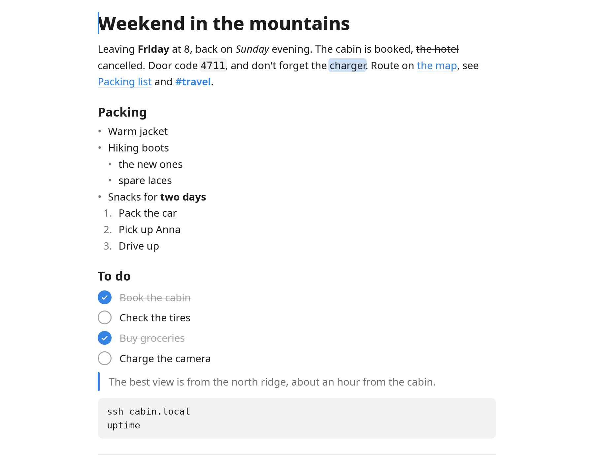
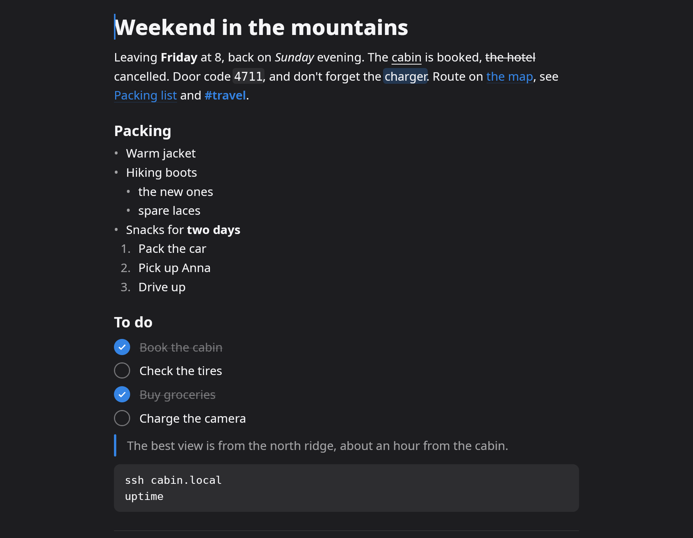

# gpui-markdown-editor

WYSIWYG Markdown editor component for GPUI (Zed's UI framework) – lossless round-trip, tables, checklists, images.


<p>
  
  
</p>

`gpui-markdown-editor` shows Markdown as formatted text while you type, like Apple Notes or Notion: no visible `**` or `#`, input rules turn `# ` into a heading and `[] ` into a checkbox. Files round-trip losslessly: what you load is saved byte for byte unless you edit it, and edited blocks are written in one consistent style. It is built for [gpui-component](https://github.com/longbridge/gpui-component) and uses its theme and widgets.

Documentation, quickstart and benchmarks: **https://taulit.github.io/gpui-markdown-editor/**

## Features

- Lossless Markdown (CommonMark, GFM tables, task lists, strikethrough): unedited blocks are written back byte for byte, unknown syntax is kept as raw blocks.
- WYSIWYG editing with Markdown input rules (`# `, `- `, `1. `, `[] `, `> `, ` ``` `, `---`, `**bold**`, `*italic*`, `~~strike~~`, `` `code` ``, `==highlight==`), undo grouped by words, IME support.
- Tables with cell editing, rectangle selection, row and column menus and keys, resizable columns.
- Images loaded asynchronously and resizable; attachments for links to local files.
- Format bar, slash menu, link popover, find bar and completions for wiki links and tags, each switchable.
- Heading folding and block drag and drop; folds and column widths are kept outside the Markdown (`DocMeta`).
- Extensions for custom inline syntax (parser, serializer, style, input rule, click event, slash entries); wiki links, tags and highlights ship with the crate. Extensions add marks only: their own inline nodes or block renderers are not possible yet.
- A window-free document model for headless use: outline, tasks, tags, rewriting.
- HTML to Markdown conversion for rich text (`markdown::html_to_markdown`).
- Accessibility roles through AccessKit; every popup works with the keyboard; motion follows GPUI's reduced-motion setting.

## Install

Not on crates.io yet. Depend on a git tag:

```toml
[dependencies]
gpui-markdown-editor = { git = "https://github.com/taulit/gpui-markdown-editor", tag = "v0.1.0" }
```

## Quick start

```rust
use gpui::{AppContext as _, Context, Entity, Window};
use gpui_markdown_editor::{EditorEvent, EditorOptions, MarkdownEditor};

fn new_editor(window: &mut Window, cx: &mut Context<Note>) -> Entity<MarkdownEditor> {
    // Once at startup: gpui_component::init(cx); gpui_markdown_editor::init(cx);
    let editor = cx.new(|cx| MarkdownEditor::new(window, cx, EditorOptions::default()));
    editor.update(cx, |editor, cx| editor.set_markdown("# Hello\n\n- [ ] try it\n", cx));
    cx.subscribe(&editor, |_, editor, event: &EditorEvent, cx| {
        if *event == EditorEvent::Changed {
            let markdown = editor.read(cx).markdown(); // save it, then `mark_saved`
        }
    })
    .detach();
    editor
}
```

Render the entity as a child of your view. Complete programs: `cargo run --example basic` (minimal), `cargo run --example notes` (every feature), `cargo run --example headless` (no window). The crate documentation (`cargo doc --open`) covers options, commands, extensions, `DocMeta`, images and key rebinding.

## Shortcuts

Cmd instead of Ctrl on macOS.

| Keys | Action |
|---|---|
| Ctrl+B / I / U | Bold, italic, underline |
| Ctrl+Shift+X, Ctrl+E, Ctrl+Shift+H | Strikethrough, inline code, highlight |
| Ctrl+K | Add or edit a link (a URL on the clipboard is pre-filled) |
| Ctrl+Alt+1 / 2 / 3, Ctrl+Alt+0 | Heading 1 to 3, plain text |
| Ctrl+Shift+L, Ctrl+Enter | Checklist, tick or untick |
| Tab, Shift+Tab | Indent, outdent; next and previous table cell |
| Alt+Up / Down | Move the block (the row in a table) |
| Ctrl+Z, Ctrl+Shift+Z or Ctrl+Y | Undo, redo |
| Ctrl+F, F3, Shift+F3 | Find, next, previous |
| Ctrl+. | Fold the heading's section |
| `/` | Slash menu |
| Ctrl+Alt+arrows | Insert a table row or column |
| Shift+F10 | Table row and column menu |

All bindings live in the key context `MarkdownEditor` and can be rebound by the host.

## Compared with gpui-component's editor

| | gpui-component `Input` / code editor | gpui-component `TextView::markdown` | gpui-markdown-editor |
|---|---|---|---|
| Edits | plain text and code (the Markdown source) | nothing, display only | formatted text (WYSIWYG) |
| Markdown | shown as source, with Tree-sitter highlighting | rendered | rendered while editing, saved losslessly |
| Made for | forms, code, large files with LSP | showing documents and chat messages | notes and documents |

Use gpui-component's code editor to edit Markdown as text, its `TextView` to display it, and this crate to let people write formatted notes that stay Markdown on disk.

## Performance

A keystroke with its frame takes about 1.5 ms in a 10,000-block document and opening 1 MB about 31 ms (budgets 4 ms and 50 ms); all numbers are in [docs/performance.md](docs/performance.md).

## Versions

| | |
|---|---|
| gpui | `gpui-pre =0.3.12` |
| gpui-component | `=0.10.0` |
| Application platform | `gpui-pre-platform =0.3.12` |
| Rust | edition 2024, MSRV 1.95 |

Host applications must use the same gpui and gpui-component versions. Changes are listed in [CHANGELOG.md](CHANGELOG.md).

## License

Apache-2.0, see [LICENSE](LICENSE).
